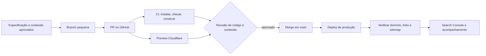

# CI/CD do projeto — guia de estudo e execução

> Proposta v0.2 — 12/11/2026. Documenta a esteira **antes de criar o site**. A automação concreta será configurada após a aprovação do [Technical Context Lite](technical-context-lite.md) e a criação do código.

## Conceitos em linguagem simples

- **Git:** registra versões do código e permite voltar a uma versão anterior.
- **Branch:** linha de trabalho isolada para uma alteração pequena.
- **Pull request (PR):** proposta de juntar a branch à `main`, com revisão e resultados das verificações.
- **CI, integração contínua:** a cada PR, instalar dependências, verificar código e construir o site automaticamente. Falha bloqueia a publicação até correção.
- **CD, entrega/implantação contínua:** após integrar código aprovado à `main`, criar e publicar a nova versão. Neste projeto, Workers Builds conectado ao GitHub pode fazer o deploy; o GitHub Actions cuida da CI.
- **Ambientes:** local (trabalho), preview (revisão por link de PR) e produção (domínio da cliente). Preview não deve conter contatos reais recebidos nem segredos.

## Esteira recomendada, do pedido ao Google

1. Escrever requisito curto e critério de aceite no backlog/knowledge base. Exemplo: “O botão WhatsApp abre conversa com o número aprovado em celular e computador”.
2. Criar branch para uma tarefa. Código gerado por IA entra como qualquer outro código: revisão de conteúdo, dependências, acessibilidade, segurança e privacidade.
3. Abrir PR pequeno. CI roda no GitHub Actions: `npm ci`, checagens de tipos/lint e `npm run build`; testes focados quando houver lógica relevante. Incluir verificação de links internos e ausência de segredos no processo de revisão.
4. Conferir preview do Cloudflare no celular e computador: texto, contraste, navegação por teclado, carregamento, links externos e conteúdo aprovado. A Soraia revisa a comunicação pública antes do primeiro lançamento.
5. Fazer merge em `main`; Cloudflare Workers Builds constrói e publica. A integração Git fornece status de build e URLs de preview por branch. Não adicionar outro workflow de deploy em paralelo.
6. No domínio final, verificar HTTPS, redirecionamento, páginas, WhatsApp/Instagram, `robots.txt`, sitemap, Search Console e rastreamento. O Google pode levar tempo para indexar; envio do sitemap não garante posição.
7. Se a versão publicada falhar, restaurar a implantação anterior no provedor ou reverter o commit e deixar a esteira publicar novamente. Registrar causa e correção.

Na etapa do formulário, acrescentar à CI testes de validação/erro sem dados reais e à revisão de preview uma checagem de que o ambiente de preview não envia mensagens para a caixa real. Na etapa da agenda, incluir testes de colisão de slots e conversão de fuso por data. Segredos de API ficam no ambiente de hospedagem, nunca no Git.

## Escolhas e trade-offs da esteira

| Opção | Quando usar | Vantagem | Cuidado |
|---|---|---|---|
| GitHub Actions para CI + Cloudflare Workers Builds para CD (**recomendado**) | MVP Astro estático com formulário/agenda futuros | Preview automático e caminho direto para API futura | Wrangler/configuração inicial mais técnicos que Pages; dois painéis para acompanhar falhas. |
| GitHub Actions para CI e deploy via Wrangler | Quando precisar de controle de versão/ambientes mais fino | Uma esteira declarada em YAML | Exige token de deploy, gestão de segredos e mais manutenção; desativar deploy Git automático para evitar duplicidade. |
| GitLab CI + Cloudflare Workers Builds | Se a equipe migrar para GitLab por motivo concreto | Integração Git suportada | Migração sem ganho identificado para o repositório atual. |

Para repositório privado no GitHub Free, considerar a franquia de Actions e as limitações de regras avançadas de proteção/ambiente do plano. Mesmo sem barreira técnica de aprovação disponível, adotar revisão de PR e publicar somente código aprovado. [GitHub: uso e cobrança do Actions](https://docs.github.com/en/billing/concepts/product-billing/github-actions); [GitHub: ambientes](https://docs.github.com/en/actions/reference/workflows-and-actions/deployments-and-environments); [Cloudflare: Workers Builds](https://developers.cloudflare.com/workers/ci-cd/builds/).

## Trilha curta de estudo

1. **Git e PR:** entender commit, branch, merge, conflito e revisão. Exercício: abrir uma branch com pequena mudança na documentação e revisar o diff.
2. **CI:** ler eventos `pull_request`/`push`, jobs, steps, runner e status. Exercício futuro: workflow que instala e constrói o Astro em PR.
3. **CD:** conectar repositório à hospedagem, ler logs de build, distinguir preview de produção, configurar domínio e rollback.
4. **Qualidade web:** HTML semântico, responsividade, navegação por teclado, imagens, metadados, sitemap e Search Console.
5. **Segurança e privacidade:** variáveis secretas, dependências, HTTPS, dados de saúde, formulário no servidor e controle antispam. Fazer esta parte antes de ativar coleta.

### Materiais oficiais para ler e praticar

- [GitHub Skills: Introduction to GitHub](https://github.com/skills/introduction-to-github) — exercícios no próprio GitHub.
- [GitHub Skills: Hello GitHub Actions](https://github.com/skills/hello-github-actions) — primeiro workflow.
- [GitHub Docs: entender GitHub Actions](https://docs.github.com/en/actions/get-started/understand-github-actions) — conceitos e sintaxe.
- [Astro: tutorial](https://docs.astro.build/en/tutorial/0-introduction/) — páginas, componentes e build.
- [Cloudflare Workers: Git integration e Builds](https://developers.cloudflare.com/workers/ci-cd/builds/) — preview e deploy.
- [Google Search Central: guia de SEO](https://developers.google.com/search/docs/fundamentals/seo-starter-guide) e [sitemaps](https://developers.google.com/search/docs/crawling-indexing/sitemaps/build-sitemap).
- [ANPD: guia de cookies](https://www.gov.br/anpd/pt-br/centrais-de-conteudo/materiais-educativos-e-publicacoes/guia_orientativo_cookies_e_protecao_de_dados_pessoais) e [segurança para pequenos agentes](https://www.gov.br/anpd/pt-br/centrais-de-conteudo/materiais-educativos-e-publicacoes/processo-guia-orientativo-sobre-seguranca-da-informacao-para-agentes-de-tratamento-de-pequeno-porte.pdf).

### Vídeos

- **Trilha em português, na ordem do trabalho:**
  1. [Dev Soutinho — O que é CI e CD? Como usar GitHub Actions?](https://www.youtube.com/watch?v=IKjcdYQvcDo) — conceito de esteira, checagens e deploy. Use para entender o fluxo inteiro antes do YAML.
  2. [Rocketseat — Configurando CI em projeto open-source com GitHub Actions](https://www.youtube.com/watch?v=IPLTUlRFxgo) — checagens disparadas por commit/PR. O vídeo é de 2020; conferir a sintaxe e versões atuais na documentação do GitHub.
  3. [Escola de Aplicativos — Cloudflare Workers: primeiro deploy (aula 02)](https://www.youtube.com/watch?v=QGdUXEt9QM4) — publicação no provedor escolhido, Static Assets e segredos. É demonstração de deploy, não substitui a configuração específica do Astro.
  4. [Escola de Aplicativos — playlist Cloudflare Workers](https://www.youtube.com/playlist?list=PLWs5cc223oy0) — depois da aula 02, consultar aulas de D1 e proteção apenas quando formulário/agenda entrarem no backlog ativo.

  Exercício para este projeto: abrir PR → observar CI no GitHub → revisar preview Cloudflare → merge em `main` → conferir produção e rollback. O roteiro completo está acima. [Roteiro do curso Cloudflare em português](https://www.escoladeaplicativos.com.br/blog/curso-gratis-cloudflare-workers).

- [GitHub for Beginners: How to use GitHub Actions](https://www.youtube.com/watch?v=BQrohJ3PT7I) — vídeo do GitHub; começar por workflow e automação de checks. [Artigo oficial com roteiro](https://github.blog/developer-skills/github/github-for-beginners-getting-started-with-github-actions/).
- [Cloudflare Developers: Astro no Cloudflare](https://www.youtube.com/watch?v=4P5xryoHUuM) — demonstra Astro e publicação; a parte de API/KV é **etapa futura**, além do MVP.
- [Google Search Central: introdução ao canal](https://www.youtube.com/watch?v=lutawRrVTHw) — porta de entrada para vídeos oficiais sobre descoberta no Google; complementar com o guia de SEO acima.

Os vídeos mostram interfaces que podem mudar; para comandos e limites usar as documentações oficiais atualizadas. Não é preciso dominar agenda, banco ou autenticação antes do MVP.

## Critério de pronto para a primeira publicação

- Contexto e textos aprovados; fotos com autorização; CRP, locais e contatos revisados.
- Build e verificações da CI aprovados; preview revisado em celular e computador, inclusive teclado.
- Aviso de privacidade fiel ao que o site usa; sem ferramenta de rastreamento não mapeada.
- Domínio em nome da cliente, DNS e HTTPS ativos; página 404 e URLs canônicas verificadas.
- Links externos e e-mail funcionais; sitemap enviado ao Search Console; plano de rollback conhecido.

**Próximo artefato de código:** após aprovar a stack, criar o projeto Astro e o workflow de CI correspondente. Este documento não afirma que a esteira já está funcionando.
