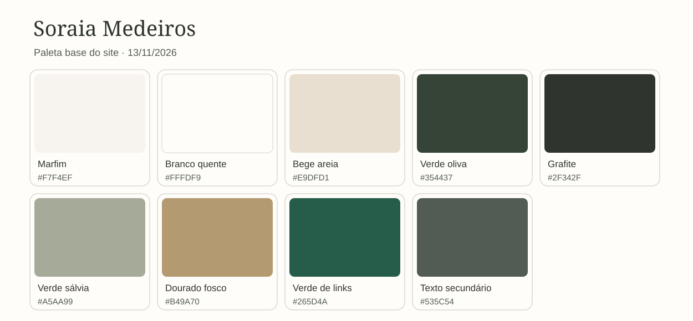

# Identidade visual e ativos — Soraia Medeiros

> Paleta base definida para a implementação em 13/11/2026. A cliente aprovou **a direção visual** (neutros, bege, off-white, detalhes verdes/dourados, sofisticação e acolhimento), mas ainda não aprovou estes códigos exatos. A versão navegável deverá ser revisada por ela antes da publicação. Fontes: [Business Context Lite](../business-context-lite.md) e artes recebidas em `public/images/referencias/` (referências locais, não assets finais).



## Paleta base

| Função | Cor | Código | Uso |
|---|---|---|---|
| Fundo principal | Marfim | `#F7F4EF` | Fundo da maior parte das páginas; mantém leitura confortável |
| Superfície | Branco quente | `#FFFDF9` | Cards, menu e áreas de texto sobre o marfim |
| Fundo alternativo | Bege areia | `#E9DFD1` | Seções alternadas e blocos de apoio |
| Cor principal | Verde oliva profundo | `#354437` | Botões primários, cabeçalho escuro e destaques fortes |
| Texto principal | Grafite | `#2F342F` | Parágrafos, títulos e informações profissionais |
| Texto secundário | Verde grafite | `#535C54` | Legendas e informações menos proeminentes, sem reduzir o tamanho da fonte |
| Apoio | Verde sálvia | `#A5AA99` | Áreas decorativas, ilustrações discretas e fundos de pequenas etiquetas com texto escuro |
| Acento | Dourado fosco | `#B49A70` | Linhas, ornamentos e detalhes da marca; não usar para texto comum ou botão claro |
| Link textual | Verde floresta | `#265D4A` | Links em fundos claros, com sublinhado visível |

O verde oliva e o dourado dialogam com a arte de apresentação enviada pela cliente. A maior parte da interface permanece clara, com bastante espaço visual, para leitura em celular e computador. A combinação comunica cuidado e maturidade sem depender de uma cor associada a um único gênero.

## Combinações e contraste

Razões calculadas para as cores sólidas acima, usando a fórmula de contraste relativa da WCAG. São verificações da **paleta**, não uma auditoria do site completo.

| Elemento | Cores | Contraste aproximado | Uso |
|---|---|---:|---|
| Texto principal | `#2F342F` sobre `#F7F4EF` | **11,58:1** | Parágrafos e títulos |
| Texto principal em card | `#2F342F` sobre `#FFFDF9` | **12,50:1** | Cards e menu |
| Texto secundário | `#535C54` sobre `#F7F4EF` | **6,32:1** | Legendas legíveis |
| Botão primário | `#F7F4EF` sobre `#354437` | **9,41:1** | Texto do botão |
| Link textual | `#265D4A` sobre `#F7F4EF` | **6,97:1** | Link sublinhado |
| Texto em seção bege | `#2F342F` sobre `#E9DFD1` | **9,64:1** | Corpo da seção |
| Dourado em fundo marfim | `#B49A70` sobre `#F7F4EF` | **2,46:1** | **Somente decorativo**; insuficiente para texto comum |

Referência: [WCAG 2.2, contraste mínimo de texto](https://www.w3.org/WAI/WCAG22/Understanding/contrast-minimum.html) recomenda pelo menos 4,5:1 para texto comum e 3:1 para texto grande; [contraste de elementos de interface](https://www.w3.org/WAI/WCAG22/Understanding/non-text-contrast.html) usa 3:1 para informação visual necessária. Conferir também estados de hover/foco, fotografias e qualquer sobreposição durante a implementação.

## Regras de uso no site

- **Botão principal:** fundo oliva `#354437`, texto marfim `#F7F4EF`; no hover, oliva mais profundo `#27362B`.
- **Botão secundário:** fundo claro, texto e borda oliva; manter área clicável evidente. Não usar dourado como único contorno de controle.
- **Links:** verde floresta `#265D4A` e sublinhado. Cor sozinha não deve ser o único sinal de interatividade.
- **Foco de teclado:** contorno oliva escuro, espesso e com espaço externo; conferir sobre todos os fundos.
- **Fotos:** texto deve ficar em painel sólido ou área separada; evitar colocar corpo de texto diretamente sobre imagem variável.
- **Seções:** alternar marfim, branco quente e bege com moderação. Sálvia e dourado funcionam como apoio, não como fundo dominante.
- **Status futuros do formulário:** definir cores de erro/sucesso quando o formulário for implementado, com texto, ícone e contraste testados. Não depender só da cor para comunicar estados.

### Tokens iniciais para CSS

```css
:root {
  --color-bg: #f7f4ef;
  --color-surface: #fffdf9;
  --color-sand: #e9dfd1;
  --color-primary: #354437;
  --color-primary-hover: #27362b;
  --color-text: #2f342f;
  --color-text-muted: #535c54;
  --color-sage: #a5aa99;
  --color-gold: #b49a70;
  --color-link: #265d4a;
}
```

## Ativos e aprovações pendentes

- Receber fotografias profissionais **originais**, confirmar autorização para uso no site e selecionar cortes apropriados para desktop e celular. As artes de WhatsApp têm texto embutido e servem apenas como referência visual.
- Confirmar se há logotipo original em vetor e direitos de uso. A arte recebida mostra um símbolo/assinatura, mas o arquivo separado ainda não foi fornecido; não redesenhar ou tratar a arte completa como logotipo final sem aprovação.
- Confirmar tipografia final. A fonte de contexto anterior propôs Cormorant Garamond para títulos e Inter ou Lato para corpo; a cliente aprovou apenas o estilo refinado, não uma família específica. Preferir arquivos de fonte locais se essas fontes forem usadas, para evitar carregamento de terceiros.
- Revisar a paleta sobre fotos reais e protótipo responsivo com a Soraia. Ajustes finos não exigem troca de stack.
